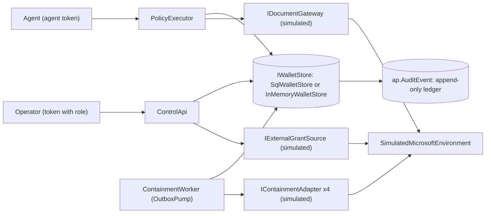
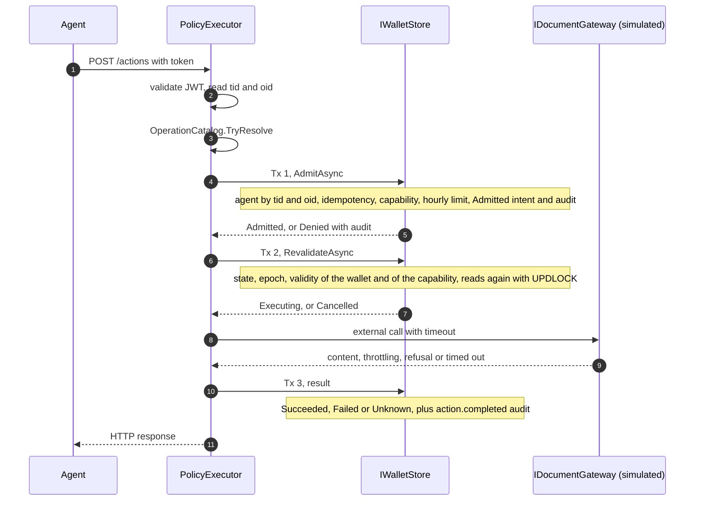
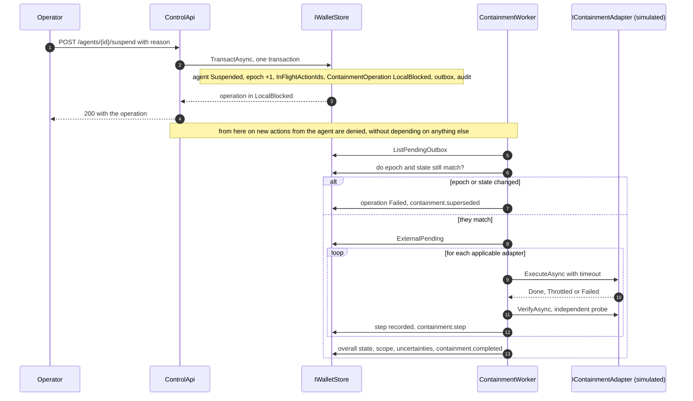

# Architecture of Agent Portifolio

This document describes what the code does today. Where the design goes beyond the code, it says so. The source of truth is `src/`.

## 1. Actual status

Phase A (validation documents): written from official documentation, without a tenant. Everything that depends on the tenant stays "TO BE FILLED IN THE TENANT".

Phase B (local vertical slice): implemented in .NET 8, without real credentials. The Microsoft side (Entra, Graph, SharePoint) is simulated in `src/Simulation`. What the simulator returns is not evidence of how those services behave.

Phases C, D and E: not executed. The Bicep in `infra/bicep` is written and has never been applied. There is no real adapter for Entra or for Graph. A host configured with any adapter mode other than `Simulation` refuses to start (section 12).

Result measured on 2026-11-11: `dotnet test` gave 78 tests, 78 passed and 0 failed, with `AP_TEST_SQL` set against a `mcr.microsoft.com/mssql/server:2022-latest` container. Without `AP_TEST_SQL`, 73 pass and 5 (class `SqlLedgerTests`) are skipped. The detail is in `test-plan.md`.

## 2. Components

| Component | Project | What it is | Holds |
| --- | --- | --- | --- |
| Core | `src/Core` | Pure domain and services: `AuthorizationEngine`, `OperationCatalog`, `ResourceCanonicalizer`, `ExecutionService`, `ControlService`, `ContainmentOrchestrator`, `ReconciliationService`, ports (`IWalletStore`, `IDocumentGateway`, `IExternalGrantSource`, `IContainmentAdapter`) and `InMemoryWalletStore`. No I/O of its own. | Rules. Talks to nothing. |
| Storage.SqlServer | `src/Storage.SqlServer` | `SqlWalletStore` on SQL Server 2022 or Azure SQL, and the `001_schema.sql` schema, embedded in the assembly. | Authoritative state and ledger. |
| Simulation | `src/Simulation` | `SimulatedMicrosoftEnvironment` and four simulated adapters, with fault injection (timeout, throttling, error). | Nothing real. Everything is simulation. |
| Hosting | `src/Hosting` | Configuration shared by the three services: JWT authentication, store selection, adapter mode, mapping of domain errors to HTTP, `DevTokens`. | Token validation. |
| ControlApi | `src/ControlApi` | Operator API (ASP.NET Core minimal API). Control plane. | Operator roles. Does not touch data. |
| PolicyExecutor | `src/PolicyExecutor` | Agent API, `POST /actions` only. Data plane. | The data credential (today the simulated gateway). The agent never receives it. |
| ContainmentWorker | `src/ContainmentWorker` | Background service that reads the database outbox and runs the containment adapters. Exposes only `/healthz`. | The containment identity (today simulated). |

There are also `samples/LocalSlice` (single-process, in-memory demonstration), `tools/DevToken` (issues development tokens) and `tests/`.

The Docker image is a single one and serves the three services. The `AP_SERVICE` variable chooses which one runs. That choice lives in the image entry point, not in `src/`.

Everything to the right of `IDocumentGateway`, `IContainmentAdapter` and `IExternalGrantSource` is simulation in this phase.

## 3. Control plane, data plane and worker

Three processes, three responsibilities. They do not share memory. They share only the database.

| Plane | Process | Token audience | Who calls | What it can do |
| --- | --- | --- | --- | --- |
| Control | `ControlApi` | `api://agent-portifolio-control` by default (`Auth:Audience`) | Operators | Register, activate, retire, suspend and reactivate agents. Grant and revoke capabilities. Register grants. Reconcile. Read state and audit. |
| Data | `PolicyExecutor` | `api://agent-portifolio-executor` by default (`Auth:Audience`) | Agents | Request an operation from the closed list. Nothing else. |
| Containment | `ContainmentWorker` | Does not validate tokens, does not receive requests | Nobody. Reads the outbox. | Execute and verify containment steps. Never reactivates. |

Rules the code enforces:

1. The caller identity comes from the validated token (claims `tid` and `oid`), never from the body. An unknown field in the body (for example `agent_id`) is rejected with 400, because `UnmappedMemberHandling` is set to `Disallow`.
2. A token with the audience of the other service is refused (401). An agent token opens nothing on the control API.
3. The executor validates the token itself, even behind a gateway. Today there is no gateway. The proof that the gateway cannot be bypassed (BT-05) belongs to phase C.
4. The control API has no route that returns document data. The executor has no management route.
5. Role checks are in `ControlService`, not only in the HTTP route, so that no host can forget them. The exception is `POST /agents/{id}/reconcile`, where the role check is in `src/ControlApi/Program.cs`.
6. Every store query carries the `tenantId`. An identifier alone is never authorisation. The only query that crosses tenants is `ListPendingOutboxAsync`, used by the worker only.

## 4. Single transactional port

`IWalletStore` has a single method: `TransactAsync<T>(Func<IWalletTx, Task<T>> work, CancellationToken)`. Everything that decides or changes state runs inside it. Either all the writes of the callback are persisted, audit and outbox included, or none are.

Two implementations:

- `SqlWalletStore`: one connection and one `ReadCommitted` transaction per call. `GetAgentAsync` reads with `UPDLOCK, ROWLOCK`, so admission and suspension of the same agent serialise on that row. `UpdateAgentAsync` uses optimistic concurrency through the `Version` column. A uniqueness violation (errors 2627 and 2601) becomes `ConcurrencyConflictException`. Any other SQL error, and pool exhaustion, become `StoreUnavailableException`. `ListPendingOutboxAsync` uses `UPDLOCK, READPAST`, so two workers do not pick up the same message at the same time.
- `InMemoryWalletStore`: local substitute, not for production. It keeps the same contract (serialised transactions, all or nothing) so the rules can be tested without infrastructure. It gives no tamper evidence. With `Storage:Provider=InMemory` each process has its own state, so it only suits a single-process demonstration or tests.

Whoever receives `StoreUnavailableException` fails closed (section 5).

## 5. Execution pipeline

`ExecutionService.ExecuteAsync` runs in three transactions, with the external call between the second and the third. There is never an open transaction during the network call.

Step by step:

1. Authenticate. The JWT is validated (signature, issuer, audience, expiry). `OnTokenValidated` refuses tokens whose `tid` is not in `Auth:AllowedTenants` or that carry no `oid`.
2. Resolve the operation. `OperationCatalog` is a closed list: `sharepoint.document.read` (arguments `siteId`, `driveId`, `itemId`) and `sharepoint.document.list` (`siteId`, `driveId`). Too many or too few arguments give `arguments_invalid`. The idempotency key must match `^[A-Za-z0-9_-]{8,128}$`. `ResourceCanonicalizer` accepts only a resource that is already canonical (`sharepoint:site/{siteId}/drive/{driveId}`) and does not normalise: an identifier that would need trimming spaces, changing case or decoding is refused with `resource_not_canonical`. There is no generic HTTP proxy, no caller URL and no batch.
3. Transaction 1, `AdmitAsync`. It resolves the agent by `(tid, oid)` and reads it again through the locking path. It applies idempotency (section 6). It calls `AuthorizationEngine.Evaluate`, which is deterministic and has no I/O: `Active` state, wallet not expired, a capability that exists for the exact action and resource and is still valid (not revoked, same epoch, not expired), and the hourly action limit. If everything passes, it records the intent as an `ActionRecord` in `Admitted` and the `action.admitted` event. If it fails, it records `action.denied` with the reason. An attempt by a suspended agent also records `alert.post_suspension_attempt`.
4. Transaction 2, `RevalidateAsync`. Before any external effect, it reads the agent and the capability again and runs `AuthorizationEngine.Revalidate`: state, epoch equal to the one at admission, wallet validity, capability state. It moves to `Executing` (`action.executing`) or to `Cancelled` (`action.cancelled_at_revalidation`). A suspension that lands between transaction 1 and 2 cancels the action with no external effect.
5. External call, with a timeout (`Execution:ExternalTimeoutSeconds`, 10 s by default). A timeout gives `Unknown` with `external_timeout`: the request may or may not have been served. Throttling gives `Failed` with `external_throttled`. A gateway refusal gives `Failed` with `external_denied`. Any other exception gives `Unknown` with `external_error_unknown`. Success is never invented.
6. Transaction 3. It records the final state (`Succeeded`, `Failed` or `Unknown`) and the `action.completed` event. It runs with `CancellationToken.None`, so a cancelled request does not leave the action without a result.

Fail-closed. If the store cannot be read or the intent cannot be written, the response is `Denied` with `state_unavailable` (HTTP 503). There is no positive cache. If transaction 3 fails, the content is not delivered to the agent: the response is `Failed` with `result_not_recorded` (503) and the action stays in `Executing` for the stale action sweep.

`ExecutionService.SweepStaleActionsAsync` closes actions left in `Admitted` (they become `Cancelled`) or in `Executing` (they become `Unknown`) with `stale_execution`. The method exists and is tested. No host calls it today: there is no scheduling. It is listed in section 15.

Mapping of result to HTTP in the executor:

| Result | HTTP |
| --- | --- |
| `Succeeded` | 200 |
| `Denied` with `state_unavailable` | 503 |
| `Denied` with `idempotency_conflict` | 409 |
| `Denied` with `arguments_invalid`, `resource_not_canonical` or `operation_not_allowlisted` | 400 |
| `Denied` with `rate_limited` | 429 |
| `Denied` with any other reason | 403 |
| `Cancelled` | 409 |
| `Failed` with `result_not_recorded` | 503 |
| `Failed` with another reason | 502 |
| `Unknown` | 504 |

Every executor response carries the `X-Correlation-Id` header and the `X-AgentPortifolio-Simulation: true` header. The latter exists while the gateway is simulated.

## 6. Idempotency

Uniqueness is `(TenantId, AgentId, IdempotencyKey)` on the `ap.Action` table. The query compares with `COLLATE Latin1_General_BIN2`, so the key is case-sensitive.

- Same key and same arguments (the `ArgumentsDigest` and the operation match): returns the previous result with `replayed: true` and does not repeat the effect. The document content is not stored, so a replay carries no content. If the action is still `Admitted` or `Executing`, the reason is `in_progress`. Otherwise it is `idempotent_replay`.
- Same key and different arguments: refused with `idempotency_conflict` (409).
- Concurrent requests with the same key: the agent row is locked in transaction 1, so only one reaches execution. A test against a real SQL Server exercises this (section 9 of `test-plan.md`).

There is no universal exactly-once for effects on Graph. Idempotency here avoids repeating an effect that this product has already recorded. It guarantees nothing about what the external service did.

## 7. Revocation epoch

`Agent.RevocationEpoch` is a counter. Each capability stores the epoch it was issued with (`IssuedEpoch`). A capability is an internal opaque reference, tied to tenant, agent, action, canonical resource, validity and epoch. It is not a JWT or a bearer token, and the agent does not present it: the server selects it from state.

The epoch rises when the agent is suspended, reactivated or retired. From then on, every capability with a different `IssuedEpoch` dies (`capability_stale_epoch`), even within its validity. They have to be granted again. Revoking a single capability does not touch the epoch, only the `PolicyVersion`.

The epoch also protects against old messages. A containment message whose epoch no longer matches the agent is discarded as `superseded` (section 8).

## 8. Suspension, outbox and containment

### Local block, in one transaction

`ControlService.SuspendAsync` (role `IncidentOperator` or `PolicyAdmin`, reason mandatory) calls `SuspendInTransactionAsync`, which in a single transaction:

1. sets the agent to `Suspended`, raises the epoch and records `SuspendedAt`;
2. lists the actions in `Admitted` or `Executing` and stores their identifiers in `InFlightActionIds`, with a declared uncertainty;
3. creates the `ContainmentOperation` in `LocalBlocked`, with scope "local admission only";
4. writes the message to the outbox (`containment.requested`, with the epoch);
5. writes the `agent.suspended` event.

When the call returns, the block is durable, whether or not there is a bus, a worker or an external service. The outbox lives in the database. There is no Service Bus.

Suspension is idempotent: asking again on an already suspended agent returns the open operation for that epoch, without raising the epoch again. Reconciliation uses the same path to suspend automatically with a null initiator (section 10).

Actions already admitted are not recalled. They stay listed in `InFlightActionIds` and the result of each one is recorded separately.

### Containment orchestrator

`ContainmentWorker` runs `OutboxPump`, which every `Worker:PollSeconds` (2 s by default) calls `ContainmentOrchestrator.ProcessPendingAsync`. A failure in a pass is logged and retried. The local block is not affected.

For each pending message:

1. it increments `Deliveries` in its own transaction. Above 5 deliveries, the message is dead-lettered and the operation marked `Failed`, with the uncertainty "Dead-lettered" and the `containment.dead_lettered` event. Resolution is manual (runbook 04);
2. `RunAsync` reads the operation and the agent. If the agent is no longer `Suspended` or the epoch differs from the operation's `EpochAfter`, the operation becomes `Failed`, records "Superseded" and the `containment.superseded` event, and no adapter runs;
3. otherwise it moves to `ExternalPending` and runs each adapter that applies to the agent, skipping steps already `Verified`;
4. at the end, `CompleteAsync` computes the overall state, the scope and the uncertainties.

The worker never reactivates an agent.

### Per-step states and overall state

`StepStatus`: `Requested`, `Executed`, `Verified`, `Failed`, `Unknown`.

- `Verified` only after an independent probe (`VerifyAsync`) confirms the effect. An administrative success response without a positive probe stays in `Executed`, with a note that it was not confirmed.
- A timeout on execution gives `Unknown` and the step is not blindly repeated.
- Throttling respects `Retry-After` up to `MaxRetryAfter` (30 s). Above that, or once the attempts are exhausted, the step stays `Requested` with the limitation "Throttled", visible as a partial state.
- Failures retry with exponential backoff up to 3 attempts and then stay `Failed`.
- `ReconcileAsync` probes again the steps that are not `Verified`. Only the probe promotes them.

`ContainmentState`: `Requested`, `LocalBlocked`, `ExternalPending`, `VerifiedScoped`, `Partial`, `Failed`, `Unknown`. The `Summarise` rule, the most pessimistic wins:

1. no steps: `LocalBlocked`;
2. all steps `Verified`: `VerifiedScoped`, and the scope lists each verified step and its resource;
3. any step `Unknown`: `Unknown`;
4. all `Failed`: `Failed`;
5. any mix: `Partial`.

`Suspended` never becomes `VerifiedScoped` on its own: the agent state and the containment state are separate machines. The `Requested` state exists in the type, but the control service creates the operation directly in `LocalBlocked`. `Failed` is also the state of a superseded or dead-lettered operation.

Every report includes the permanent uncertainty about tokens already issued: "Access tokens issued before this operation may stay valid until they expire. Continuous access evaluation is not guaranteed for this identity and resource."

### Adapters (all simulated)

| Step name | Applies to | Permanent limitation declared |
| --- | --- | --- |
| `identity.disable` | Agents that are not a managed identity | Blocking new issuance does not prove that earlier tokens stopped working. |
| `grants.remove` | All | Covers only the grants known to this product. Other paths have to be inventoried separately. |
| `runtime.isolate` | All | None declared. |
| `tokens.probe` | All | The probe covers one test resource and the tokens it knows about. |

Each `Simulated*` class is marked as simulation. None talks to Entra, Graph or Azure. The real behaviour of each step is the subject of phases C and D.

## 9. Two-person reactivation

Reactivating is a new activation, not an undo.

1. `POST /agents/{id}/reactivation-requests` (`PolicyAdmin`): the agent must be `Suspended`. It records who asked in `ReviewRequestedBy`. No body.
2. `POST /agents/{id}/reactivation-approvals` (`PolicyAdmin`): the agent must be `Suspended`, the request must exist and the approver must be someone else (refused with 403 if it is the same person). Every registered external grant must have a `LastVerifiedAt` later than `SuspendedAt`, otherwise 409 `grants_not_revalidated`. Re-verification is done with `POST /agents/{id}/reconcile` or `POST /agents/{id}/grants`.
3. If it passes: state `Active`, epoch +1, `PolicyVersion` +1, `ReviewRequestedBy` and `SuspendedAt` cleared.
4. Earlier capabilities stay dead (`capability_stale_epoch`). They have to be granted again.
5. An old containment message that arrives later is discarded as `superseded` and does not touch the reactivated agent.

Initial activation also requires two people: `submit` records who submitted and `approve` refuses the same person.

Reactivating the agent in this application does not reactivate anything in Entra or on the resources. Whatever containment changed outside (identity, grants, runtime) is restored by hand (runbook 03).

## 10. Reconciliation and drift

`ReconciliationService.ReconcileAsync` reads the grants observed for the executor and for the agent identity (outside a transaction, with no lock held during the network call) and compares them with the registered ones and with the active capabilities. Then, in one transaction:

| Finding | When | Dangerous |
| --- | --- | --- |
| `broad_grant` | The type is in the list of tenant-wide scope names (`Sites.Read.All`, `Sites.ReadWrite.All`, `Sites.Manage.All`, `Sites.FullControl.All`, `Files.Read.All`, `Files.ReadWrite.All`, `Mail.Read`, `Mail.ReadWrite`, `Mail.Send`) | Yes |
| `direct_access` | Any other grant on the agent's own identity | No |
| `unexpected_grant` | Executor grant that is not registered or whose resource is not covered by an active capability | No |

The list of broad names is not exhaustive. Each finding generates an event (`alert.broad_grant`, `alert.direct_access_discovered` or `alert.drift_detected`). Registered grants that no longer appear become `absent` (`grant.absent`). Observed grants are recorded with the current `LastVerifiedAt`.

The agent's coverage becomes `DirectAccessPossible` if there is `direct_access` or `broad_grant`, and `GatewayEnforced` otherwise (event `coverage.changed`). This only reflects grants. It does not prove the absence of other paths (network, local credentials). It is a limitation of what the code measures, not a conclusion about the tenant.

A dangerous finding on an `Active` agent suspends it in the same transaction, through the same path as manual suspension, with a null initiator and `system` access.

Reconciliation only runs when someone calls the route. There is no periodic execution.

## 11. SQL schema

The schema is in `src/Storage.SqlServer/Schema/001_schema.sql`. It is idempotent and runs at start-up if `Storage:EnsureSchema` is true (it is by default). Creating the ledger table requires the `ENABLE LEDGER` permission. In environments where the execution identities do not have it, set `Storage__EnsureSchema=false` and apply the schema with an administrative account. The local stack uses an `sa` account and so does not have this problem. The production design does not give `ENABLE LEDGER` to any execution identity: this point is not resolved in the code, which by default tries to create the schema (see `backlog.md`).

| Table | Keys and indexed columns | Holds |
| --- | --- | --- |
| `ap.Agent` | `Id`; unique `(TenantId, IdentityObjectId)`; `State`, `RevocationEpoch`, `Version` | Agent record in `Doc` (JSON). |
| `ap.Capability` | `Id`; index `(TenantId, AgentId)`; `IssuedAt` | Capability in `Doc`. |
| `ap.ExternalGrant` | `Id`; index `(TenantId, AgentId)`; `ExternalId` | Mirror of external grants in `Doc`. |
| `ap.Action` | `Id`; unique `(TenantId, AgentId, IdempotencyKey)`; `AdmittedAt`, `State` | Intent and result in `Doc`. Digest of the arguments, not the arguments. |
| `ap.ContainmentOperation` | `Id`; index `(TenantId, AgentId, RequestedAt)`; `EpochAfter` | Operation, steps and uncertainties in `Doc`. |
| `ap.Outbox` | `Id`; index `(ProcessedAt, CreatedAt)`; `Epoch` | Containment messages in `Doc`. |
| `ap.AuditEvent` | No key of its own. 23 typed columns. | Append-only ledger. |

The state tables are normal tables, because they need `UPDATE`. The database is not a ledger database: only `ap.AuditEvent` is a ledger, table by table, with `WITH (LEDGER = ON (APPEND_ONLY = ON))`. The decision on whether the database is a ledger database or not is irreversible and belongs to phase A (ADR 0004).

`ap.AuditEvent` stores, per event: identifier, schema version, tenant, agent, `OccurredAt`, `RecordedAt` (SQL server time), event type, correlation, human initiator, caller identity, executing identity, access mode, policy version, epoch, capability, resource, operation, decision, reason, execution state, attempt, idempotency key and evidence reference. It does not store tokens, document content, prompts or the arguments in clear. Reads are ordered by `ledger_start_transaction_id` and `ledger_start_sequence_number`.

What is known about the ledger, checked against documentation on 2026-11-11:

- Append-only tables "allow only INSERT operations on your tables, which ensure that privileged users such as database administrators can't alter data through traditional Data Manipulation Language operations". https://learn.microsoft.com/en-us/sql/relational-databases/security/ledger/ledger-append-only-ledger-tables
- The block on `UPDATE` and `DELETE` is at the API level (DML). "The verification process and the integrity of the database depend on the integrity of the input digests." Without digests stored outside the database and periodic verification, the tamper detection guarantee does not exist in practice. It is tamper evidence, not prevention. https://learn.microsoft.com/en-us/sql/relational-databases/security/ledger/ledger-database-verification
- "Deleting older data in append-only ledger tables or the history table of updatable ledger tables isn't supported." This weighs on personal data and on retention. https://learn.microsoft.com/en-us/sql/relational-databases/security/ledger/ledger-limits
- Creating append-only tables requires `ENABLE LEDGER`. https://learn.microsoft.com/en-us/sql/relational-databases/security/ledger/ledger-how-to-append-only-ledger-tables

NOT VERIFIED: the exact number and text of the error on an `UPDATE` or `DELETE` against the table. The tests only confirm that the engine rejects it (`BT16_Ledger_table_rejects_update_and_delete`).

Locally, it was verified against a real SQL Server 2022 that `UPDATE`, `DELETE` and `TRUNCATE` on `ap.AuditEvent` are rejected and that `sys.sp_verify_database_ledger` accepts a generated digest and rejects an altered digest. There are no digests in independent immutable storage and no Azure SQL: that is phase C.

## 12. Authentication and adapter mode

### Authentication

`Auth:Mode` is mandatory and has no default value. A host without an explicit mode does not start. `Auth:AllowedTenants` is also mandatory: an empty list would accept all tenants, so it is an error.

| Mode | Validation | Use |
| --- | --- | --- |
| `Entra` | Signature, issuer, audience, expiry and tenant against the metadata of `Auth:Authority`. The accepted issuer is whatever that metadata declares. | For environments with a tenant. Has never been exercised against a real tenant. |
| `Development` | Local symmetric key (`Auth:DevSigningKey`, at least 32 bytes) and fixed issuer `https://dev-issuer.agent-portifolio.invalid`. | Local slice and tests only. Start-up logs a warning. Do not expose. |

In both modes: `MapInboundClaims` off, signature required, `ClockSkew` of 30 s, user name from the `oid` claim and roles from the `roles` claim. The role values are `AgentPortifolio.Reader`, `AgentPortifolio.IncidentOperator`, `AgentPortifolio.PolicyAdmin` and `AgentPortifolio.Auditor`.

NOT VERIFIED: that a real token from an agent identity carries `tid` and `oid` with the meaning the code assumes, and that the roles reach the token with these names. See `gaps-and-assumptions.md` (P-02 and P-19).

`tools/DevToken` issues development tokens. Hosts in `Entra` mode do not accept them.

### Adapter mode

`Adapters:Mode` is mandatory. The only accepted value is `Simulation`. Any other value makes the host fail at start-up, with the message that the real Microsoft adapters are blocked until the phase A gates are approved. This is deliberate: it does not pretend a real adapter exists. The real adapters do not exist.

Start-up always logs a warning that the adapters are running in simulation and that nothing the host reports about Entra, Graph or SharePoint is real evidence. In `Simulation`, the executor can be seeded with sample libraries and documents through the `Simulation` section.

## 13. HTTP routes

All routes, except `/healthz`, require a valid token. The JSON names follow the ASP.NET Core defaults (camelCase) and enums travel as text. Unknown fields in the body are rejected (400).

### ControlApi

| Method and path | Required role | Body | Response |
| --- | --- | --- | --- |
| `GET /healthz` | None | | 200 `{"status":"ok"}`. Does not check the database. |
| `GET /agents` | `Reader`, `IncidentOperator`, `PolicyAdmin` or `Auditor` | | List of the tenant's agents. |
| `POST /agents` | `PolicyAdmin` | `identityType`, `identityObjectId`, `blueprintId?`, `executorObjectId`, `runtime`, `purpose`, `ownerObjectId`, `sponsorObjectId?`, `contact`, `maxActionsPerHour`, `walletExpiresAt` | 201 with the agent in `Draft`. |
| `GET /agents/{id}` | The four read roles | | Agent, capabilities and grants. |
| `POST /agents/{id}/submit` | `PolicyAdmin` | | Agent in `PendingReview`. |
| `POST /agents/{id}/approve` | `PolicyAdmin`, different from whoever submitted | | Agent in `Active`. |
| `POST /agents/{id}/retire` | `PolicyAdmin` | | Agent in `Retired`, epoch +1. Does not create a containment operation. |
| `POST /agents/{id}/capabilities` | `PolicyAdmin` | `action`, `resource`, `expiresAt` (in the future and at most 90 days) | 201 with the capability. |
| `DELETE /agents/{id}/capabilities/{capabilityId}` | `IncidentOperator` or `PolicyAdmin` | | The revoked capability. Idempotent. |
| `POST /agents/{id}/grants` | `PolicyAdmin` | `principalObjectId`, `type`, `externalId`, `resource`, `role`, `source` | The grant, verified now. |
| `POST /agents/{id}/reconcile` | `PolicyAdmin` or `IncidentOperator` (checked in `Program.cs`) | | Report: findings, whether it suspended, coverage. |
| `POST /agents/{id}/suspend` | `IncidentOperator` or `PolicyAdmin` | `{"reason":"..."}` | The `ContainmentOperation`. Idempotent. |
| `POST /agents/{id}/reactivation-requests` | `PolicyAdmin` | None | The agent with the request recorded. |
| `POST /agents/{id}/reactivation-approvals` | `PolicyAdmin`, different from whoever requested | None | The agent in `Active`. |
| `GET /agents/{id}/containments` | The four read roles | | The agent's containment operations. |
| `GET /agents/{id}/audit` | `Auditor` | | The agent's audit events. |

Domain errors, with the body `{"error":"<code>","detail":"..."}` (without `detail` on 503): `ForbiddenException` gives 403 `forbidden`, `NotFoundException` gives 404 `not_found` (also for an agent of another tenant), `RequestValidationException` and malformed requests give 400 `invalid_request`, `InvalidTransitionException` gives 409 with the transition code (for example `invalid_state`, `grants_not_revalidated`), `ConcurrencyConflictException` gives 409 `conflict`, and `StoreUnavailableException` gives 503 `state_unavailable`.

### PolicyExecutor

| Method and path | Authentication | Body | Response |
| --- | --- | --- | --- |
| `GET /healthz` | None | | 200 `{"status":"ok"}` |
| `POST /actions` | Token with the executor audience, whose `(tid, oid)` is that of a registered agent | `operation`, `arguments` (text map), `idempotencyKey` | `actionId`, `status`, `reasonCode`, `replayed`, `result`. HTTP status codes in section 5. |

On a read, `result` carries `name`, `contentType` and `contentBase64`. On a listing it carries `items`. It never carries a credential, a download URL or an authorisation header.

## 14. Configuration

.NET reads configuration from environment variables with `__` as the level separator (for example `Auth__Mode`).

| Key | Read by | Required | Values and default |
| --- | --- | --- | --- |
| `Auth:Mode` | ControlApi, PolicyExecutor | Yes | `Entra` or `Development`. No default. |
| `Auth:Authority` | ControlApi, PolicyExecutor | In `Entra` mode | Authority URL. |
| `Auth:Audience` | ControlApi, PolicyExecutor | No | `api://agent-portifolio-control` on the control API, `api://agent-portifolio-executor` on the executor. |
| `Auth:AllowedTenants` (`Auth__AllowedTenants__0`, `__1`, ...) | ControlApi, PolicyExecutor | Yes | Tenant GUIDs. An empty list is an error. |
| `Auth:DevSigningKey` | ControlApi, PolicyExecutor | In `Development` mode | At least 32 bytes. |
| `Storage:Provider` | All three | Yes | `SqlServer` or `InMemory`. No default. |
| `Storage:ConnectionString` | All three | With `SqlServer` | String passed as is to `Microsoft.Data.SqlClient` (version 7.1.1 in `Directory.Packages.props`). |
| `Storage:EnsureSchema` | All three | No | Default `true`. With `SqlServer`, applies the schema at start-up, with up to 30 attempts, 2 s apart. |
| `Storage:CreateDatabase` | All three | No | Default `false`. With `true` and `Storage:EnsureSchema`, the service creates the database if it does not exist. For the local stack only (`docker-compose.yml` sets it to `true`). In Azure the database belongs to the infrastructure. |
| `Adapters:Mode` | All three | Yes | `Simulation` only. |
| `Simulation:Libraries` (`Simulation__Libraries__0__SiteId`, `__DriveId`, `__GrantedExecutors__0`, `__Documents__0__ItemId`, `__Name`, `__Text`) | All three, in `Simulation` mode | No | Seed of the simulated world. A library outside the canonical form makes start-up fail. |
| `Execution:ExternalTimeoutSeconds` | PolicyExecutor | No | Default 10. |
| `Worker:PollSeconds` | ContainmentWorker | No | Default 2. |
| `AP_SERVICE` | Image entry point | In the image | `control`, `executor`, `worker`, `demo` or `devtoken`. Not read by `src/`. |

The `ContainmentOptions` limits (3 attempts, 10 s per attempt, base backoff of 500 ms, maximum `Retry-After` of 30 s, 5 deliveries) are the code defaults and are not configurable today. The hourly action limit is a field of the agent (`maxActionsPerHour`, mandatory and positive), not a host setting. These values are start-up values, not calibrated ones (`gaps-and-assumptions.md`, P-21).

The ControlApi does not read `Execution:*` or `Worker:*`. The ContainmentWorker does not read `Auth:*`.

## 15. What does not exist yet

None of the following is implemented. This document must not be read as if it were.

- Real adapters for Entra and Graph (identity disabling, removal of Selected grants, reading grants, reading and listing documents). Today only `Simulated*` exist. Phases C and D.
- Azure API Management as a gateway. The Bicep has a module written and never applied. The executor validates tokens by itself, but the proof that the gateway cannot be bypassed (BT-05) belongs to phase C.
- Azure Service Bus. Delivery is only through the database outbox, read by the worker. Real redelivery, dead-letter and deduplication have not been exercised.
- `AdminUi` (`src/AdminUi`). Postponed. The Control API is the interface. See `src/AdminUi/README.md`.
- Scheduled sweep of stale actions. `SweepStaleActionsAsync` exists, but no host calls it.
- Periodic reconciliation. `ReconciliationService` only runs when `POST /agents/{id}/reconcile` is called.
- Containment on retiring an agent. `retire` raises the epoch, but does not create a containment operation or write to the outbox.
- Refusal of two agents with the same `ExecutorObjectId`. The code refuses only an executor equal to the agent identity, and the database uniqueness is `(TenantId, IdentityObjectId)`.
- Ledger digests in immutable storage, scheduled verification and real restore or failover (full BT-16 and BT-17). Phase C.
- Measurement of what happens to tokens already issued (BT-14) and a break-glass rehearsal with the application down (BT-20). Phase D.
- Metrics, traces and alerts. The code only writes start-up and worker pass failure logs.
- Phases C, D and E: test Azure, real containment and pilot.

The full matrix of tests and of what is missing for each proof is in `test-plan.md`.
