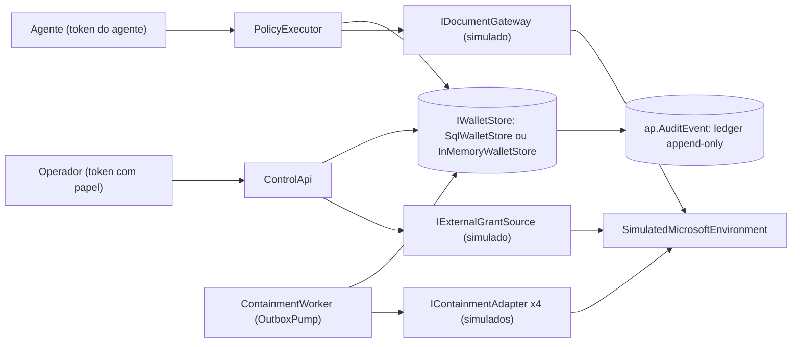
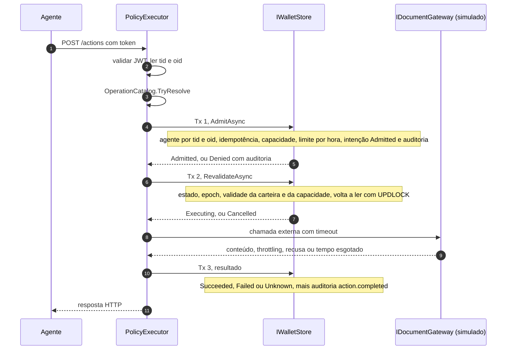
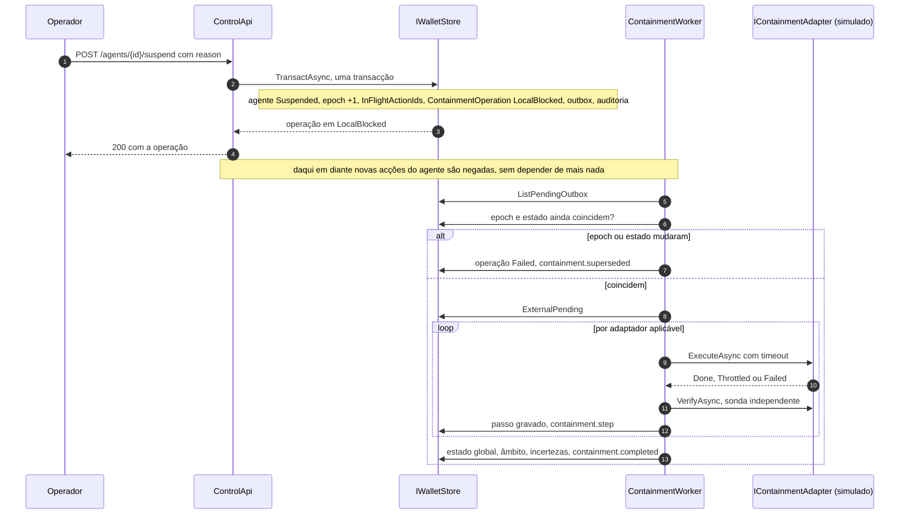

# Arquitectura do Agent Portifolio

Este documento descreve o que o código faz hoje. Onde o desenho vai além do código, diz-se. A fonte de verdade é `src/`.

## 1. Estado real

Fase A (documentos de validação): escrita a partir de documentação oficial, sem tenant. Tudo o que depende do tenant fica "POR PREENCHER NO TENANT".

Fase B (fatia vertical local): implementada em .NET 8, sem credenciais reais. O lado Microsoft (Entra, Graph, SharePoint) é simulado em `src/Simulation`. O que o simulador devolve não é evidência de como esses serviços se comportam.

Fases C, D e E: não executadas. O Bicep em `infra/bicep` está escrito e nunca foi aplicado. Não existe adaptador real para Entra nem para Graph. Um host configurado com qualquer modo de adaptadores que não seja `Simulation` recusa-se a arrancar (secção 12).

Resultado medido em 2026-11-11: `dotnet test` deu 78 testes, 78 passaram e 0 falharam, com `AP_TEST_SQL` definido contra um contentor `mcr.microsoft.com/mssql/server:2022-latest`. Sem `AP_TEST_SQL`, 73 passam e 5 (classe `SqlLedgerTests`) ficam ignorados. O detalhe está em `test-plan.md`.

## 2. Componentes

| Componente | Projecto | O que é | Detém |
| --- | --- | --- | --- |
| Core | `src/Core` | Domínio puro e serviços: `AuthorizationEngine`, `OperationCatalog`, `ResourceCanonicalizer`, `ExecutionService`, `ControlService`, `ContainmentOrchestrator`, `ReconciliationService`, portas (`IWalletStore`, `IDocumentGateway`, `IExternalGrantSource`, `IContainmentAdapter`) e `InMemoryWalletStore`. Sem I/O próprio. | Regras. Não fala com nada. |
| Storage.SqlServer | `src/Storage.SqlServer` | `SqlWalletStore` sobre SQL Server 2022 ou Azure SQL, e o esquema `001_schema.sql`, embutido no assembly. | Estado autoritativo e ledger. |
| Simulation | `src/Simulation` | `SimulatedMicrosoftEnvironment` e quatro adaptadores simulados, com injecção de falhas (timeout, throttling, erro). | Nada real. Tudo é simulação. |
| Hosting | `src/Hosting` | Configuração comum dos três serviços: autenticação JWT, escolha do armazém, modo de adaptadores, mapeamento de erros de domínio para HTTP, `DevTokens`. | Validação de tokens. |
| ControlApi | `src/ControlApi` | API do operador (ASP.NET Core minimal API). Plano de controlo. | Papéis dos operadores. Não toca em dados. |
| PolicyExecutor | `src/PolicyExecutor` | API do agente, só `POST /actions`. Plano de dados. | A credencial de dados (hoje o gateway simulado). O agente nunca a recebe. |
| ContainmentWorker | `src/ContainmentWorker` | Serviço em segundo plano que lê a outbox da base de dados e corre os adaptadores de contenção. Só expõe `/healthz`. | A identidade de contenção (hoje simulada). |

Há ainda `samples/LocalSlice` (demonstração numa só processo, em memória), `tools/DevToken` (emite tokens de desenvolvimento) e `tests/`.

A imagem Docker é única e serve os três serviços. A variável `AP_SERVICE` escolhe qual corre. Essa escolha vive no ponto de entrada da imagem, não em `src/`.

Tudo o que está à direita de `IDocumentGateway`, `IContainmentAdapter` e `IExternalGrantSource` é simulação nesta fase.

## 3. Plano de controlo, plano de dados e worker

Três processos, três responsabilidades. Não partilham memória. Partilham só a base de dados.

| Plano | Processo | Audiência do token | Quem chama | O que pode fazer |
| --- | --- | --- | --- | --- |
| Controlo | `ControlApi` | `api://agent-portifolio-control` por omissão (`Auth:Audience`) | Operadores | Registar, activar, retirar, suspender e reactivar agentes. Conceder e revogar capacidades. Registar grants. Reconciliar. Ler estado e auditoria. |
| Dados | `PolicyExecutor` | `api://agent-portifolio-executor` por omissão (`Auth:Audience`) | Agentes | Pedir uma operação da lista fechada. Nada mais. |
| Contenção | `ContainmentWorker` | Não valida tokens, não recebe pedidos | Ninguém. Lê a outbox. | Executar e verificar passos de contenção. Nunca reactiva. |

Regras que o código impõe:

1. A identidade do chamador vem do token validado (claims `tid` e `oid`), nunca do corpo. Um campo desconhecido no corpo (por exemplo `agent_id`) é rejeitado com 400, porque `UnmappedMemberHandling` está em `Disallow`.
2. Um token com a audiência do outro serviço é recusado (401). Um token do agente não abre nada na API de controlo.
3. O executor valida o token ele próprio, mesmo atrás de um gateway. Hoje não existe gateway. A prova de que o gateway não é contornável (BT-05) pertence à fase C.
4. A API de controlo não tem rota que devolva dados dos documentos. O executor não tem rota de gestão.
5. As verificações de papel estão em `ControlService`, não só na rota HTTP, para que nenhum anfitrião as esqueça. A excepção é `POST /agents/{id}/reconcile`, onde a verificação de papel está em `src/ControlApi/Program.cs`.
6. Toda a consulta ao armazém leva o `tenantId`. Um identificador sozinho nunca é autorização. A única consulta que atravessa tenants é `ListPendingOutboxAsync`, só do worker.

## 4. Porta transaccional única

`IWalletStore` tem um único método: `TransactAsync<T>(Func<IWalletTx, Task<T>> work, CancellationToken)`. Tudo o que decide ou muda estado corre dentro dele. Ou todas as escritas do callback ficam persistidas, auditoria e outbox incluídas, ou nenhuma fica.

Duas implementações:

- `SqlWalletStore`: uma ligação e uma transacção `ReadCommitted` por chamada. `GetAgentAsync` lê com `UPDLOCK, ROWLOCK`, por isso a admissão e a suspensão do mesmo agente serializam-se nessa linha. `UpdateAgentAsync` usa concorrência optimista pela coluna `Version`. Uma violação de unicidade (erros 2627 e 2601) vira `ConcurrencyConflictException`. Qualquer outro erro de SQL, e o esgotamento do pool, viram `StoreUnavailableException`. `ListPendingOutboxAsync` usa `UPDLOCK, READPAST`, para dois workers não apanharem a mesma mensagem ao mesmo tempo.
- `InMemoryWalletStore`: substituto local, não é para produção. Mantém o mesmo contrato (transacções serializadas, tudo ou nada) para testar as regras sem infraestrutura. Não dá evidência de adulteração. Em `Storage:Provider=InMemory` cada processo tem o seu próprio estado, por isso só serve numa demonstração de um só processo ou em testes.

Quem recebe `StoreUnavailableException` falha fechado (secção 5).

## 5. Pipeline de execução

`ExecutionService.ExecuteAsync` corre em três transacções, com a chamada externa entre a segunda e a terceira. Nunca há uma transacção aberta durante a chamada de rede.

Passo a passo:

1. Autenticar. O JWT é validado (assinatura, emissor, audiência, validade). `OnTokenValidated` recusa tokens cujo `tid` não esteja em `Auth:AllowedTenants` ou que não tragam `oid`.
2. Resolver a operação. `OperationCatalog` é uma lista fechada: `sharepoint.document.read` (argumentos `siteId`, `driveId`, `itemId`) e `sharepoint.document.list` (`siteId`, `driveId`). Argumentos a mais ou a menos dão `arguments_invalid`. A chave de idempotência tem de casar com `^[A-Za-z0-9_-]{8,128}$`. `ResourceCanonicalizer` só aceita um recurso já canónico (`sharepoint:site/{siteId}/drive/{driveId}`) e não normaliza: um identificador que precisasse de aparar espaços, mudar maiúsculas ou descodificar é recusado com `resource_not_canonical`. Não há proxy HTTP genérico, URL do chamador nem batch.
3. Transacção 1, `AdmitAsync`. Resolve o agente por `(tid, oid)` e volta a lê-lo pelo caminho com bloqueio. Aplica a idempotência (secção 6). Chama `AuthorizationEngine.Evaluate`, que é determinístico e sem I/O: estado `Active`, carteira não expirada, capacidade existente para a acção e o recurso exactos e ainda válida (não revogada, mesma epoch, não expirada), e limite de acções por hora. Se tudo passa, grava a intenção como `ActionRecord` em `Admitted` e o evento `action.admitted`. Se falha, grava `action.denied` com o motivo. Uma tentativa de agente suspenso grava também `alert.post_suspension_attempt`.
4. Transacção 2, `RevalidateAsync`. Antes de qualquer efeito externo, relê agente e capacidade e corre `AuthorizationEngine.Revalidate`: estado, epoch igual à da admissão, validade da carteira, estado da capacidade. Passa a `Executing` (`action.executing`) ou a `Cancelled` (`action.cancelled_at_revalidation`). Uma suspensão que caia entre a transacção 1 e a 2 cancela a acção sem efeito externo.
5. Chamada externa, com timeout (`Execution:ExternalTimeoutSeconds`, 10 s por omissão). Tempo esgotado dá `Unknown` com `external_timeout`: o pedido pode ter sido servido ou não. Throttling dá `Failed` com `external_throttled`. Recusa do gateway dá `Failed` com `external_denied`. Qualquer outra excepção dá `Unknown` com `external_error_unknown`. Nunca se inventa sucesso.
6. Transacção 3. Grava o estado final (`Succeeded`, `Failed` ou `Unknown`) e o evento `action.completed`. Corre com `CancellationToken.None`, para um pedido cancelado não deixar a acção sem resultado.

Falha fechada. Se o armazém não puder ser lido ou a intenção não puder ser escrita, a resposta é `Denied` com `state_unavailable` (HTTP 503). Não existe cache positiva. Se a transacção 3 falhar, o conteúdo não é entregue ao agente: a resposta é `Failed` com `result_not_recorded` (503) e a acção fica em `Executing` para a limpeza de acções paradas.

`ExecutionService.SweepStaleActionsAsync` fecha acções que ficaram em `Admitted` (passam a `Cancelled`) ou em `Executing` (passam a `Unknown`) com `stale_execution`. O método existe e está testado. Nenhum host o chama hoje: não há agendamento. Está listado na secção 15.

Mapeamento de resultado para HTTP no executor:

| Resultado | HTTP |
| --- | --- |
| `Succeeded` | 200 |
| `Denied` com `state_unavailable` | 503 |
| `Denied` com `idempotency_conflict` | 409 |
| `Denied` com `arguments_invalid`, `resource_not_canonical` ou `operation_not_allowlisted` | 400 |
| `Denied` com `rate_limited` | 429 |
| `Denied` com qualquer outro motivo | 403 |
| `Cancelled` | 409 |
| `Failed` com `result_not_recorded` | 503 |
| `Failed` com outro motivo | 502 |
| `Unknown` | 504 |

Toda a resposta do executor leva o cabeçalho `X-Correlation-Id` e o cabeçalho `X-AgentPortifolio-Simulation: true`. Este último existe enquanto o gateway for simulado.

## 6. Idempotência

A unicidade é `(TenantId, AgentId, IdempotencyKey)` na tabela `ap.Action`. A consulta compara com `COLLATE Latin1_General_BIN2`, por isso a chave é sensível a maiúsculas.

- Mesma chave e mesmos argumentos (o `ArgumentsDigest` e a operação coincidem): devolve o resultado anterior com `replayed: true` e não repete o efeito. O conteúdo do documento não é guardado, por isso uma repetição não traz conteúdo. Se a acção ainda estiver `Admitted` ou `Executing`, o motivo é `in_progress`. Caso contrário é `idempotent_replay`.
- Mesma chave e argumentos diferentes: recusado com `idempotency_conflict` (409).
- Pedidos concorrentes com a mesma chave: a linha do agente está bloqueada na transacção 1, por isso só um chega a executar. Um teste contra SQL Server real exercita isto (secção 9 de `test-plan.md`).

Não existe exactly-once universal para efeitos no Graph. A idempotência aqui evita repetir um efeito que este produto já registou. Não garante nada sobre o que o serviço externo fez.

## 7. Epoch de revogação

`Agent.RevocationEpoch` é um contador. Cada capacidade guarda a epoch com que foi emitida (`IssuedEpoch`). Uma capacidade é uma referência opaca interna, ligada a tenant, agente, acção, recurso canónico, validade e epoch. Não é JWT nem token ao portador, e o agente não a apresenta: o servidor selecciona-a do estado.

A epoch sobe quando o agente é suspenso, reactivado ou retirado. Daí em diante, toda a capacidade com `IssuedEpoch` diferente morre (`capability_stale_epoch`), mesmo dentro da validade. Têm de ser concedidas de novo. Revogar uma só capacidade não mexe na epoch, só na `PolicyVersion`.

A epoch também protege contra mensagens antigas. Uma mensagem de contenção cuja epoch já não corresponde ao agente é descartada como `superseded` (secção 8).

## 8. Suspensão, outbox e contenção

### Bloqueio local, numa transacção

`ControlService.SuspendAsync` (papel `IncidentOperator` ou `PolicyAdmin`, motivo obrigatório) chama `SuspendInTransactionAsync`, que numa só transacção:

1. põe o agente em `Suspended`, sobe a epoch e regista `SuspendedAt`;
2. lista as acções em `Admitted` ou `Executing` e guarda os seus identificadores em `InFlightActionIds`, com uma incerteza declarada;
3. cria a `ContainmentOperation` em `LocalBlocked`, com âmbito "local admission only";
4. escreve a mensagem na outbox (`containment.requested`, com a epoch);
5. escreve o evento `agent.suspended`.

Quando a chamada devolve, o bloqueio é durável, haja ou não bus, worker ou serviço externo. A outbox vive na base de dados. Não existe Service Bus.

A suspensão é idempotente: pedir de novo sobre um agente já suspenso devolve a operação aberta para essa epoch, sem subir a epoch outra vez. A reconciliação usa o mesmo caminho para suspender automaticamente com iniciador nulo (secção 10).

Acções já admitidas não se recolhem. Ficam listadas em `InFlightActionIds` e o resultado de cada uma fica registado à parte.

### Orquestrador de contenção

`ContainmentWorker` corre `OutboxPump`, que a cada `Worker:PollSeconds` (2 s por omissão) chama `ContainmentOrchestrator.ProcessPendingAsync`. Uma falha numa passagem é registada e repetida. O bloqueio local não é afectado.

Para cada mensagem pendente:

1. incrementa `Deliveries` numa transacção própria. Acima de 5 entregas, a mensagem é posta em dead-letter e a operação marcada `Failed`, com a incerteza "Dead-lettered" e o evento `containment.dead_lettered`. A resolução é manual (runbook 04);
2. `RunAsync` lê a operação e o agente. Se o agente já não está `Suspended` ou a epoch difere da `EpochAfter` da operação, a operação passa a `Failed`, regista "Superseded" e o evento `containment.superseded`, e nenhum adaptador corre;
3. caso contrário passa a `ExternalPending` e corre cada adaptador que se aplica ao agente, saltando passos já `Verified`;
4. no fim, `CompleteAsync` calcula o estado global, o âmbito e as incertezas.

O worker nunca reactiva um agente.

### Estados por passo e estado global

`StepStatus`: `Requested`, `Executed`, `Verified`, `Failed`, `Unknown`.

- `Verified` só depois de uma sonda independente (`VerifyAsync`) confirmar o efeito. Uma resposta administrativa de sucesso sem sonda positiva fica em `Executed`, com a nota de que não foi confirmada.
- Tempo esgotado na execução dá `Unknown` e o passo não é repetido às cegas.
- Throttling respeita `Retry-After` até `MaxRetryAfter` (30 s). Acima disso, ou esgotadas as tentativas, o passo fica `Requested` com a limitação "Throttled", visível como estado parcial.
- Falhas repetem com backoff exponencial até 3 tentativas e depois ficam `Failed`.
- `ReconcileAsync` volta a sondar os passos que não estão `Verified`. Só a sonda os promove.

`ContainmentState`: `Requested`, `LocalBlocked`, `ExternalPending`, `VerifiedScoped`, `Partial`, `Failed`, `Unknown`. A regra de `Summarise`, a mais pessimista ganha:

1. sem passos: `LocalBlocked`;
2. todos os passos `Verified`: `VerifiedScoped`, e o âmbito lista cada passo verificado e o seu recurso;
3. algum passo `Unknown`: `Unknown`;
4. todos `Failed`: `Failed`;
5. qualquer mistura: `Partial`.

`Suspended` nunca passa sozinho a `VerifiedScoped`: o estado do agente e o da contenção são máquinas separadas. O estado `Requested` existe no tipo, mas o serviço de controlo cria a operação directamente em `LocalBlocked`. `Failed` também é o estado de uma operação superada ou posta em dead-letter.

Todo o relatório inclui a incerteza permanente sobre tokens já emitidos: "Access tokens issued before this operation may stay valid until they expire. Continuous access evaluation is not guaranteed for this identity and resource."

### Adaptadores (todos simulados)

| Nome do passo | Aplica-se a | Limitação permanente declarada |
| --- | --- | --- |
| `identity.disable` | Agentes que não são managed identity | Bloquear emissão nova não prova que tokens anteriores deixaram de funcionar. |
| `grants.remove` | Todos | Cobre só os grants conhecidos deste produto. Outros caminhos têm de ser inventariados à parte. |
| `runtime.isolate` | Todos | Nenhuma declarada. |
| `tokens.probe` | Todos | A sonda cobre um recurso de teste e os tokens que conhece. |

Cada classe `Simulated*` está marcada como simulação. Nenhum fala com Entra, Graph ou Azure. O comportamento real de cada passo é o objecto das fases C e D.

## 9. Reactivação a dois

Reactivar é uma nova activação, não um desfazer.

1. `POST /agents/{id}/reactivation-requests` (`PolicyAdmin`): o agente tem de estar `Suspended`. Regista quem pediu em `ReviewRequestedBy`. Sem corpo.
2. `POST /agents/{id}/reactivation-approvals` (`PolicyAdmin`): o agente tem de estar `Suspended`, o pedido tem de existir e o aprovador tem de ser outra pessoa (recusa com 403 se for a mesma). Todo o grant externo registado tem de ter `LastVerifiedAt` posterior a `SuspendedAt`, senão 409 `grants_not_revalidated`. A reverificação faz-se com `POST /agents/{id}/reconcile` ou `POST /agents/{id}/grants`.
3. Se passa: estado `Active`, epoch +1, `PolicyVersion` +1, `ReviewRequestedBy` e `SuspendedAt` limpos.
4. As capacidades anteriores continuam mortas (`capability_stale_epoch`). Têm de ser concedidas de novo.
5. Uma mensagem de contenção antiga que chegue depois é descartada como `superseded` e não toca no agente reactivado.

A activação inicial também exige duas pessoas: `submit` regista quem submeteu e `approve` recusa a mesma pessoa.

Reactivar o agente nesta aplicação não reactiva nada no Entra nem nos recursos. O que a contenção tiver alterado fora (identidade, grants, runtime) repõe-se à mão (runbook 03).

## 10. Reconciliação e drift

`ReconciliationService.ReconcileAsync` lê os grants observados para o executor e para a identidade do agente (fora de transacção, sem bloqueio durante a rede) e compara-os com os registados e com as capacidades activas. Depois, numa transacção:

| Constatação | Quando | Perigosa |
| --- | --- | --- |
| `broad_grant` | O tipo está na lista de nomes de âmbito de tenant (`Sites.Read.All`, `Sites.ReadWrite.All`, `Sites.Manage.All`, `Sites.FullControl.All`, `Files.Read.All`, `Files.ReadWrite.All`, `Mail.Read`, `Mail.ReadWrite`, `Mail.Send`) | Sim |
| `direct_access` | Qualquer outro grant na identidade do próprio agente | Não |
| `unexpected_grant` | Grant do executor que não está registado ou cujo recurso não está coberto por uma capacidade activa | Não |

A lista de nomes largos não é exaustiva. Cada constatação gera um evento (`alert.broad_grant`, `alert.direct_access_discovered` ou `alert.drift_detected`). Grants registados que já não aparecem passam a `absent` (`grant.absent`). Os grants observados são gravados com `LastVerifiedAt` actual.

A cobertura do agente passa a `DirectAccessPossible` se houver `direct_access` ou `broad_grant`, e a `GatewayEnforced` caso contrário (evento `coverage.changed`). Isto só reflecte grants. Não prova a ausência de outros caminhos (rede, credenciais locais). É uma limitação do que o código mede, não uma conclusão sobre o tenant.

Uma constatação perigosa sobre um agente `Active` suspende-o na mesma transacção, pelo mesmo caminho da suspensão manual, com iniciador nulo e acesso `system`.

A reconciliação só corre quando alguém chama a rota. Não há execução periódica.

## 11. Esquema SQL

O esquema está em `src/Storage.SqlServer/Schema/001_schema.sql`. É idempotente e corre no arranque se `Storage:EnsureSchema` for verdadeiro (por omissão é). Criar a tabela de ledger exige a permissão `ENABLE LEDGER`. Em ambientes onde as identidades de execução não a têm, pôr `Storage__EnsureSchema=false` e aplicar o esquema com uma conta administrativa. A pilha local usa uma conta `sa` e por isso não tem este problema. O desenho de produção não dá `ENABLE LEDGER` a nenhuma identidade de execução: esse ponto não está resolvido no código, que por omissão tenta criar o esquema (ver `backlog.md`).

| Tabela | Chaves e colunas indexadas | Guarda |
| --- | --- | --- |
| `ap.Agent` | `Id`; único `(TenantId, IdentityObjectId)`; `State`, `RevocationEpoch`, `Version` | Registo do agente em `Doc` (JSON). |
| `ap.Capability` | `Id`; índice `(TenantId, AgentId)`; `IssuedAt` | Capacidade em `Doc`. |
| `ap.ExternalGrant` | `Id`; índice `(TenantId, AgentId)`; `ExternalId` | Espelho de grants externos em `Doc`. |
| `ap.Action` | `Id`; único `(TenantId, AgentId, IdempotencyKey)`; `AdmittedAt`, `State` | Intenção e resultado em `Doc`. Digest dos argumentos, não os argumentos. |
| `ap.ContainmentOperation` | `Id`; índice `(TenantId, AgentId, RequestedAt)`; `EpochAfter` | Operação, passos e incertezas em `Doc`. |
| `ap.Outbox` | `Id`; índice `(ProcessedAt, CreatedAt)`; `Epoch` | Mensagens de contenção em `Doc`. |
| `ap.AuditEvent` | Sem chave própria. 23 colunas tipadas. | Ledger append-only. |

As tabelas de estado são normais, porque precisam de `UPDATE`. A base de dados não é uma base ledger: só `ap.AuditEvent` é ledger, tabela a tabela, com `WITH (LEDGER = ON (APPEND_ONLY = ON))`. A decisão de a base ser ledger ou não é irreversível e pertence à fase A (ADR 0004).

`ap.AuditEvent` guarda, por evento: identificador, versão de esquema, tenant, agente, `OccurredAt`, `RecordedAt` (hora do servidor SQL), tipo de evento, correlação, iniciador humano, identidade do chamador, identidade executora, modo de acesso, versão de política, epoch, capacidade, recurso, operação, decisão, motivo, estado de execução, tentativa, chave de idempotência e referência de evidência. Não guarda tokens, conteúdo de documentos, prompts nem os argumentos em claro. A leitura ordena por `ledger_start_transaction_id` e `ledger_start_sequence_number`.

O que se sabe da ledger, verificado em documentação a 2026-11-11:

- Tabelas append-only "allow only INSERT operations on your tables, which ensure that privileged users such as database administrators can't alter data through traditional Data Manipulation Language operations". https://learn.microsoft.com/en-us/sql/relational-databases/security/ledger/ledger-append-only-ledger-tables
- O bloqueio de `UPDATE` e `DELETE` é ao nível da API (DML). "The verification process and the integrity of the database depend on the integrity of the input digests." Sem digests guardados fora da base e verificação periódica, a garantia de detecção de adulteração não existe na prática. É evidência de adulteração, não prevenção. https://learn.microsoft.com/en-us/sql/relational-databases/security/ledger/ledger-database-verification
- "Deleting older data in append-only ledger tables or the history table of updatable ledger tables isn't supported." Isto pesa em dados pessoais e em retenção. https://learn.microsoft.com/en-us/sql/relational-databases/security/ledger/ledger-limits
- Criar tabelas append-only exige `ENABLE LEDGER`. https://learn.microsoft.com/en-us/sql/relational-databases/security/ledger/ledger-how-to-append-only-ledger-tables

NÃO VERIFICADO: o número e o texto exactos do erro num `UPDATE` ou `DELETE` sobre a tabela. Os testes só confirmam que o motor rejeita (`BT16_Ledger_table_rejects_update_and_delete`).

Localmente, verificou-se contra SQL Server 2022 real que `UPDATE`, `DELETE` e `TRUNCATE` sobre `ap.AuditEvent` são rejeitados e que `sys.sp_verify_database_ledger` aceita um digest gerado e rejeita um digest alterado. Não existem digests em armazenamento imutável independente nem Azure SQL: isso é a fase C.

## 12. Autenticação e modo de adaptadores

### Autenticação

`Auth:Mode` é obrigatório e não tem valor por omissão. Um host sem modo explícito não arranca. `Auth:AllowedTenants` também é obrigatório: uma lista vazia aceitaria todos os tenants, por isso é erro.

| Modo | Validação | Uso |
| --- | --- | --- |
| `Entra` | Assinatura, emissor, audiência, validade e tenant contra os metadados de `Auth:Authority`. O emissor aceite é o que esses metadados declararem. | Para ambientes com tenant. Nunca foi exercido contra um tenant real. |
| `Development` | Chave simétrica local (`Auth:DevSigningKey`, pelo menos 32 bytes) e emissor fixo `https://dev-issuer.agent-portifolio.invalid`. | Só a fatia local e os testes. O arranque regista um aviso. Não expor. |

Nos dois modos: `MapInboundClaims` desligado, assinatura obrigatória, `ClockSkew` de 30 s, nome do utilizador pelo claim `oid` e papéis pelo claim `roles`. Os valores de papel são `AgentPortifolio.Reader`, `AgentPortifolio.IncidentOperator`, `AgentPortifolio.PolicyAdmin` e `AgentPortifolio.Auditor`.

NÃO VERIFICADO: que um token real de uma agent identity transporte `tid` e `oid` com o significado que o código assume, e que os papéis cheguem ao token com estes nomes. Ver `gaps-and-assumptions.md` (P-02 e P-19).

`tools/DevToken` emite tokens de desenvolvimento. Os hosts em modo `Entra` não os aceitam.

### Modo de adaptadores

`Adapters:Mode` é obrigatório. O único valor aceite é `Simulation`. Qualquer outro valor faz o host falhar no arranque, com a mensagem de que os adaptadores Microsoft reais estão bloqueados até os gates da fase A serem aprovados. Isto é deliberado: não se finge que existe um adaptador real. Os adaptadores reais não existem.

O arranque regista sempre um aviso de que os adaptadores correm em simulação e de que nada do que o host reporta sobre Entra, Graph ou SharePoint é evidência real. Em `Simulation`, o executor pode ser semeado com bibliotecas e documentos de exemplo pela secção `Simulation`.

## 13. Rotas HTTP

Todas as rotas, excepto `/healthz`, exigem token válido. Os nomes JSON seguem os padrões do ASP.NET Core (camelCase) e os enums viajam como texto. Campos desconhecidos no corpo são rejeitados (400).

### ControlApi

| Método e caminho | Papel exigido | Corpo | Resposta |
| --- | --- | --- | --- |
| `GET /healthz` | Nenhum | | 200 `{"status":"ok"}`. Não verifica a base de dados. |
| `GET /agents` | `Reader`, `IncidentOperator`, `PolicyAdmin` ou `Auditor` | | Lista de agentes do tenant. |
| `POST /agents` | `PolicyAdmin` | `identityType`, `identityObjectId`, `blueprintId?`, `executorObjectId`, `runtime`, `purpose`, `ownerObjectId`, `sponsorObjectId?`, `contact`, `maxActionsPerHour`, `walletExpiresAt` | 201 com o agente em `Draft`. |
| `GET /agents/{id}` | Os quatro papéis de leitura | | Agente, capacidades e grants. |
| `POST /agents/{id}/submit` | `PolicyAdmin` | | Agente em `PendingReview`. |
| `POST /agents/{id}/approve` | `PolicyAdmin`, diferente de quem submeteu | | Agente em `Active`. |
| `POST /agents/{id}/retire` | `PolicyAdmin` | | Agente em `Retired`, epoch +1. Não cria operação de contenção. |
| `POST /agents/{id}/capabilities` | `PolicyAdmin` | `action`, `resource`, `expiresAt` (futura e no máximo 90 dias) | 201 com a capacidade. |
| `DELETE /agents/{id}/capabilities/{capabilityId}` | `IncidentOperator` ou `PolicyAdmin` | | A capacidade revogada. Idempotente. |
| `POST /agents/{id}/grants` | `PolicyAdmin` | `principalObjectId`, `type`, `externalId`, `resource`, `role`, `source` | O grant, verificado agora. |
| `POST /agents/{id}/reconcile` | `PolicyAdmin` ou `IncidentOperator` (verificado em `Program.cs`) | | Relatório: constatações, se suspendeu, cobertura. |
| `POST /agents/{id}/suspend` | `IncidentOperator` ou `PolicyAdmin` | `{"reason":"..."}` | A `ContainmentOperation`. Idempotente. |
| `POST /agents/{id}/reactivation-requests` | `PolicyAdmin` | Nenhum | O agente com o pedido registado. |
| `POST /agents/{id}/reactivation-approvals` | `PolicyAdmin`, diferente de quem pediu | Nenhum | O agente em `Active`. |
| `GET /agents/{id}/containments` | Os quatro papéis de leitura | | Operações de contenção do agente. |
| `GET /agents/{id}/audit` | `Auditor` | | Eventos de auditoria do agente. |

Erros de domínio, com o corpo `{"error":"<código>","detail":"..."}` (sem `detail` em 503): `ForbiddenException` dá 403 `forbidden`, `NotFoundException` dá 404 `not_found` (também para um agente de outro tenant), `RequestValidationException` e pedidos mal formados dão 400 `invalid_request`, `InvalidTransitionException` dá 409 com o código da transição (por exemplo `invalid_state`, `grants_not_revalidated`), `ConcurrencyConflictException` dá 409 `conflict`, e `StoreUnavailableException` dá 503 `state_unavailable`.

### PolicyExecutor

| Método e caminho | Autenticação | Corpo | Resposta |
| --- | --- | --- | --- |
| `GET /healthz` | Nenhuma | | 200 `{"status":"ok"}` |
| `POST /actions` | Token com a audiência do executor, cujo `(tid, oid)` seja o de um agente registado | `operation`, `arguments` (mapa de texto), `idempotencyKey` | `actionId`, `status`, `reasonCode`, `replayed`, `result`. Estados HTTP na secção 5. |

`result` traz, na leitura, `name`, `contentType` e `contentBase64`. Na listagem traz `items`. Nunca traz credencial, URL de descarga ou cabeçalho de autorização.

## 14. Configuração

O .NET lê a configuração por variáveis de ambiente com `__` como separador de nível (por exemplo `Auth__Mode`).

| Chave | Quem lê | Obrigatória | Valores e omissão |
| --- | --- | --- | --- |
| `Auth:Mode` | ControlApi, PolicyExecutor | Sim | `Entra` ou `Development`. Sem omissão. |
| `Auth:Authority` | ControlApi, PolicyExecutor | Em modo `Entra` | URL da autoridade. |
| `Auth:Audience` | ControlApi, PolicyExecutor | Não | `api://agent-portifolio-control` na API de controlo, `api://agent-portifolio-executor` no executor. |
| `Auth:AllowedTenants` (`Auth__AllowedTenants__0`, `__1`, ...) | ControlApi, PolicyExecutor | Sim | GUIDs de tenant. Lista vazia é erro. |
| `Auth:DevSigningKey` | ControlApi, PolicyExecutor | Em modo `Development` | Pelo menos 32 bytes. |
| `Storage:Provider` | Os três | Sim | `SqlServer` ou `InMemory`. Sem omissão. |
| `Storage:ConnectionString` | Os três | Com `SqlServer` | Cadeia passada tal e qual ao `Microsoft.Data.SqlClient` (versão 7.1.1 em `Directory.Packages.props`). |
| `Storage:EnsureSchema` | Os três | Não | Omissão `true`. Com `SqlServer`, aplica o esquema no arranque, com até 30 tentativas a cada 2 s. |
| `Storage:CreateDatabase` | Os três | Não | Omissão `false`. Com `true` e `Storage:EnsureSchema`, o serviço cria a base se não existir. Só para a pilha local (`docker-compose.yml` põe-na a `true`). Em Azure a base é da infra-estrutura. |
| `Adapters:Mode` | Os três | Sim | Só `Simulation`. |
| `Simulation:Libraries` (`Simulation__Libraries__0__SiteId`, `__DriveId`, `__GrantedExecutors__0`, `__Documents__0__ItemId`, `__Name`, `__Text`) | Os três, em modo `Simulation` | Não | Semente do mundo simulado. Uma biblioteca fora da forma canónica faz o arranque falhar. |
| `Execution:ExternalTimeoutSeconds` | PolicyExecutor | Não | Omissão 10. |
| `Worker:PollSeconds` | ContainmentWorker | Não | Omissão 2. |
| `AP_SERVICE` | Ponto de entrada da imagem | Na imagem | `control`, `executor`, `worker`, `demo` ou `devtoken`. Não é lida por `src/`. |

Os limites de `ContainmentOptions` (3 tentativas, 10 s por tentativa, backoff base de 500 ms, `Retry-After` máximo de 30 s, 5 entregas) são os valores por omissão do código e não são configuráveis hoje. O limite de acções por hora é um campo do agente (`maxActionsPerHour`, obrigatório e positivo), não uma configuração do host. Estes valores são de arranque, não de calibração (`gaps-and-assumptions.md`, P-21).

O ControlApi não lê `Execution:*` nem `Worker:*`. O ContainmentWorker não lê `Auth:*`.

## 15. O que não existe ainda

Nada do que se segue está implementado. Não se deve ler este documento como se estivesse.

- Adaptadores reais para Entra e Graph (desactivação de identidade, remoção de grants Selected, leitura de grants, leitura e listagem de documentos). Hoje só existem `Simulated*`. Fases C e D.
- Azure API Management como gateway. O Bicep tem um módulo escrito e nunca aplicado. O executor valida tokens por si, mas a prova de que o gateway não é contornável (BT-05) é da fase C.
- Azure Service Bus. A entrega é só pela outbox na base de dados, lida pelo worker. Reentrega, dead-letter e deduplicação reais não foram exercidas.
- `AdminUi` (`src/AdminUi`). Adiada. A Control API é a interface. Ver `src/AdminUi/README.md`.
- Limpeza agendada de acções paradas. `SweepStaleActionsAsync` existe, mas nenhum host o chama.
- Reconciliação periódica. `ReconciliationService` só corre quando se chama `POST /agents/{id}/reconcile`.
- Contenção ao retirar um agente. `retire` sobe a epoch, mas não cria operação de contenção nem escreve na outbox.
- Recusa de dois agentes com o mesmo `ExecutorObjectId`. O código recusa só o executor igual à identidade do agente, e a unicidade da base é `(TenantId, IdentityObjectId)`.
- Digests da ledger em armazenamento imutável, verificação agendada e restauro ou failover reais (BT-16 completo e BT-17). Fase C.
- Medição do que acontece aos tokens já emitidos (BT-14) e ensaio de break-glass com a aplicação em baixo (BT-20). Fase D.
- Métricas, traços e alertas. O código só escreve registos de arranque e de falha de passagem do worker.
- Fases C, D e E: Azure de teste, contenção real e piloto.

A matriz completa de testes e do que falta para cada prova está em `test-plan.md`.
